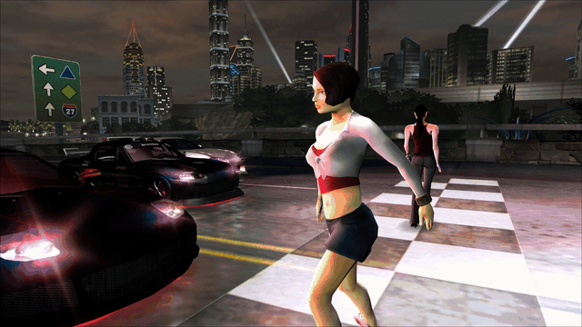

# NFSU2 Split Screen

Local **split screen for 2-6 players** in *Need for Speed Underground 2* on PC.

Every race mode, Free Run across the whole city, full graphics in every view, and full native controller support:
rumble, triggers, lightbars and pad speakers.

This is beta 0.12.0, so expect the odd bug; see [Bugs and crashes](#bugs-and-crashes).

## Install
1. You need `speed2.exe` **v1.2** and [WidescreenFix](https://github.com/ThirteenAG/WidescreenFixesPack/releases/tag/nfsu2)
   (recommended) or at least the [Ultimate ASI Loader](https://github.com/ThirteenAG/Ultimate-ASI-Loader).
2. Download the [latest release](https://github.com/mihaits/NFSU2-SplitScreen/releases) and copy
   `NFSU2SplitScreen.asi` and `NFSU2SplitScreen.ini` into the game's `scripts` folder.

## Controllers
Xbox, DualSense and DualShock 4 pads are all supported natively, over USB or Bluetooth. One player can use the keyboard.

## Play
1. Main menu → **Split-Screen** (next to Quick Race).
2. Pick the race type, track, the number of **Players**, **Opponents** (AI) and their **Difficulty**. **Free Run**
   (the last mode) drops you in the city with no race; its **Start** row picks where: a city district, Random, or a
   closed venue (speedways, drift areas).
3. Each player presses **START** on their own pad and picks a car. On the keyboard, press **Enter** on your Press START
   screen. Back only undoes your own step.

Every player has their own controls page (Options → Controls) and their own player options. Pausing opens the
options of whoever paused.

**Handy buttons:**
- **Mute** (DualSense), **touchpad click** (DualShock 4): moves your car's sound between your pad's speaker and the PC.
  With more than 2 Bluetooth DualSense players the speakers start off (too much for one adapter); Mute turns yours on.
- **Y / Space** on player 1's Press START: rematch with the same cars and controllers.
- **START** on a spare pad: take over a player whose controller turned off.

## Features
**Split screen**
- 2 to 6 players in every race mode (Outrun: 2 players, drag: up to 4)
- 2P top / bottom or left / right, quadrants, 3 + 2, 3 × 2
- Each player has their own view, HUD, gauges, minimap, camera, controls, options and last car
- Full graphics in every view: reflections, rain, headlights, blur, light streaks, overbright, anti-aliasing

**Racing**
- AI opponents with difficulty (up to 6 racers in all), catch-up between players, traffic around every player
- Free Run: drive the whole city together from the district or venue you pick
- Tuned headlight colours work, also in single player: the original PC game turns bright ones white

**Controllers**
- DualSense natively: rumble, player LEDs, RPM / nitrous lightbar, adaptive triggers
- DualShock 4 natively: rumble, lightbar in the player's colour with the start lights and podium colours
- Xbox One / Series impulse triggers, Forza Horizon style: they buzz with wheelspin and brake slip
- Each player's car sounds on their own pad's speaker, Bluetooth or USB (first-model DualShock 4: Bluetooth only)

## Settings
`NFSU2SplitScreen.ini` explains every option (rumble and trigger strength, lightbar, gauges, ...). The ones you
are most likely to change:

| Setting | Default | |
|---|---|---|
| `VerticalSplit` | 0 | 2P views left / right (0: top / bottom) |
| `PadSpeakers` | 1 | car sounds on each player's DualSense or DualShock 4 speaker (0: all on the PC) |
| `PadSpeakerGain` | 400 | pad speaker volume (%) |
| `RumbleStrength` | 100 | rumble strength (%) |
| `AdaptiveTriggers` | 1 | DualSense and Xbox impulse trigger effects (also per player in the pause options) |
| `GaugeScalePercent` | 60 | gauge size |

## Troubleshooting
- **The game's sound moved to a USB PlayStation pad:** Windows may switch its default output when you plug one in. Switch
  it back in the Windows sound settings.
- **PlayStation pad features are missing:** native support turns off while DS4Windows exposes its virtual Xbox pad.

## Bugs and crashes
Known bugs are in [open issues](docs/open-issues.md). If you hit a new one, please
[open an issue](https://github.com/mihaits/NFSU2-SplitScreen/issues): fill in the [bug report template](docs/bug-report.md)
and attach `scripts\NFSU2SplitScreen.log` (set `Debug = 1` in the ini to write it). After a crash, also attach
`scripts\NFSU2SplitScreen_crash.txt` and the newest `scripts\NFSU2SplitScreen_crash_*.dmp`.

## Mod compatibility
| Mod | Status |
|---|---|
| [WidescreenFix](https://github.com/ThirteenAG/WidescreenFixesPack/releases/tag/nfsu2) | recommended; works, its free camera per player included |
| underground2.net 1.0.3 | works |
| XtendedInput | not recommended: replaces the same controller input code, and this mod already handles pads per player |

Not tested yet: NFSU2 Extra Options, NFSU2 Unlimiter, NFSU2 HD Reflections, NFSU2 Redux.

## Linux compatibility
Tested up to 4 players with GE-Proton through Lutris. Setup, pad support and optional Bluetooth tweaks are in [docs/linux.md](docs/linux.md).

## To do
- [ ] Pad speakers (DualSense and DualShock 4) with an adaptive bitrate, so 3-6 pads can stream at once over Bluetooth
- [ ] Session results: standings across back-to-back races
- [ ] Replays of split-screen races
- [ ] Rear-view mirror in the bumper and hood cameras, like single player
- [ ] Maybe: everyone picking a car at once; press START to join at any time
- [ ] Free Run: game modes like a waypoint race (see [Free Run ideas](docs/free-run.md#ideas-not-built-yet))

## For developers
Build with Visual Studio 2022 Build Tools (C++, x86): run `build.bat`.
[`docs/TECHNICAL.md`](docs/TECHNICAL.md) explains how everything works, for anyone (or any AI agent) continuing the
work; [`tools/`](tools) has the testing and reverse-engineering helpers.

## License
MIT. Need for Speed Underground 2 is © Electronic Arts; this project contains no game code or data.
`third_party/opus` is libopus 1.5.2 (BSD, see its `COPYING`), built into the plugin for the DualSense speaker.
