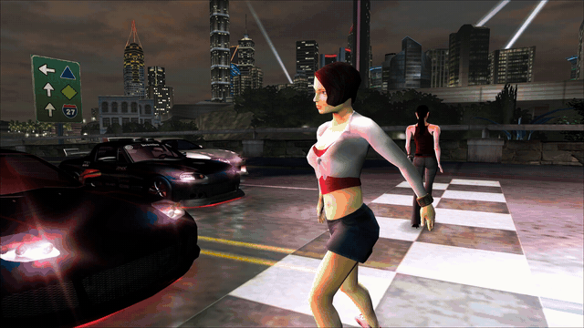

# NFSU2 Split Screen

Local **split screen for 2-6 players** in *Need for Speed Underground 2* on PC.

## Install
1. You need `speed2.exe` **v1.2** and the [Ultimate ASI Loader](https://github.com/ThirteenAG/Ultimate-ASI-Loader).
   [WidescreenFix](https://github.com/ThirteenAG/WidescreenFixesPack/releases/tag/nfsu2) is recommended (widescreen,
   free camera) and already includes the loader.
2. Download the [latest release](https://github.com/mihaits/NFSU2-SplitScreen/releases) and copy
   `NFSU2SplitScreen.asi` and `NFSU2SplitScreen.ini` into the game's `scripts` folder.
3. One controller per player. Xbox pads work directly (up to 4: the XInput limit); PlayStation DualSense pads work
   natively (USB or Bluetooth, up to 8) or through DS4Windows. For 5-6 players use native DualSense pads (DS4Windows
   off) for the players past the 4th Xbox pad, or the keyboard for one player.

## Play
1. Main menu → **Split-Screen** (next to Quick Race).
2. Pick the race type, track, the number of **Players**, **Opponents** (AI) and their **Difficulty**. **Free Run**
   (the last mode) drops you in the city with no race; its **Start** row picks where: a city district, Random, or a
   closed venue (speedways, drift areas).
3. Each player presses **START** on their own pad and picks a car. One player can use the keyboard instead: press
   **Enter** on their Press START screen. Back undoes only your own step: on your car choice it returns to your Press
   START screen, and on the next player's Press START screen only you can go back to your car choice.

Every player has their own controls page (Options → Controls) and their own player options. Pausing opens the
options of whoever paused.

**Handy buttons:**
- **Mute** (DualSense): moves your car's sound from your pad's speaker back to the PC, and again to switch back.
  With more than 2 DualSense players the speakers start off (too much for one Bluetooth adapter); Mute turns yours on.
- **Y / Space** on player 1's Press START: rematch with the same cars and controllers.
- **START** on a spare pad: take over a player whose controller turned off.

## Features
**Split screen**
- 2 to 6 players in every race mode (Outrun 2, drag up to 4): halves, quadrants, 3 + 2, 3 × 2
- Each player has their own view, HUD, gauges, minimap, camera, controls, options and last car
- Full graphics in every view: reflections, rain, headlights, blur, light streaks, overbright, anti-aliasing

**Racing**
- AI opponents with difficulty (up to 6 racers in all), catch-up between players, traffic around every player
- Free Run: drive the whole city together from the district or venue you pick
- Rematch without picking cars again

**Controllers**
- DualSense without DS4Windows: rumble, player LEDs, RPM / nitrous lightbar, adaptive triggers
- Xbox One / Series impulse triggers, Forza Horizon style: they buzz with wheelspin and brake slip
- Each player's car sounds on their own DualSense's speaker (Bluetooth), so the cars don't overlap on the PC
- A controller that turns off keeps its player; a spare one can take over

## To do
- [ ] More than 4 Xbox pads (Windows.Gaming.Input backend)
- [ ] DualSense speaker over USB
- [ ] DualSense speaker at a lower bitrate, so 3-6 pads can stream at once over Bluetooth
- [ ] DualShock 4 without DS4Windows: input, rumble, player-coloured lightbar
- [ ] Session results: standings across back-to-back races
- [ ] Replays of split-screen races
- [ ] Rear-view mirror in the bumper and hood cameras, like single player
- [ ] Maybe: everyone picking a car at once; press START to join at any time
- [ ] Free Run: game modes like a waypoint race (see [Free Run ideas](docs/free-run.md#ideas-not-built-yet))

This is beta 0.11.0, so expect the odd bug; known ones are in [open issues](docs/open-issues.md). If you hit one, please
[open an issue](https://github.com/mihaits/NFSU2-SplitScreen/issues): fill in the [bug report template](docs/bug-report.md)
and attach `scripts\NFSU2SplitScreen.log` (set `Debug = 1` in the ini to write it).

## Settings
`NFSU2SplitScreen.ini` explains every option (rumble and trigger strength, lightbar, gauges, ...). The ones you
are most likely to change:

| Setting | Default | |
|---|---|---|
| `PadSpeakers` | 1 | car sounds on each player's DualSense speaker (0: all on the PC) |
| `PadSpeakerGain` | 400 | pad speaker volume (%) |
| `RumbleStrength` | 100 | rumble strength (%) |
| `AdaptiveTriggers` | 1 | DualSense and Xbox impulse trigger effects (also per player in the pause options) |
| `GaugeScalePercent` | 60 | gauge size |

## Mod compatibility
| Mod | Status |
|---|---|
| [WidescreenFix](https://github.com/ThirteenAG/WidescreenFixesPack/releases/tag/nfsu2) | recommended; works, its free camera per player included; not tested without it |
| underground2.net 1.0.3 | works (tested); the mod removes its old WidescreenFix's joystick hook, which made the menus press Up endlessly |
| NFSU2 Extra Options | testing pending |
| NFSU2 Unlimiter | testing pending |
| NFSU2 HD Reflections | testing pending |
| NFSU2 Redux | testing pending |
| XtendedInput | not recommended: replaces the same controller input code, and this mod already handles Xbox and DualSense pads per player |

## For developers
Build with Visual Studio 2022 Build Tools (C++, x86): run `build.bat`.
[`docs/TECHNICAL.md`](docs/TECHNICAL.md) explains how everything works, for anyone (or any AI agent) continuing the
work; [`tools/`](tools) has the testing and reverse-engineering helpers.

## License
MIT. Need for Speed Underground 2 is © Electronic Arts; this project contains no game code or data.
`third_party/opus` is libopus 1.5.2 (BSD, see its `COPYING`), built into the plugin for the DualSense speaker.
