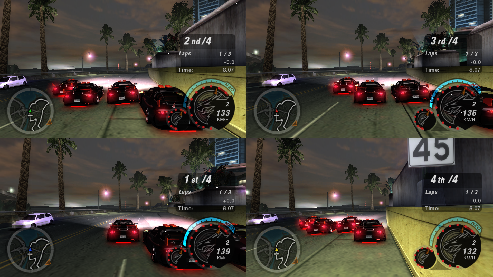

# NFSU2 Split Screen

Local **split screen for 2-4 players** in *Need for Speed Underground 2* on PC.

**Status: 0.9.3 alpha.** Every race mode works with 2-4 players.

## Install
1. You need `speed2.exe` **v1.2** and the [Ultimate ASI Loader](https://github.com/ThirteenAG/Ultimate-ASI-Loader).
   [WidescreenFix](https://github.com/ThirteenAG/WidescreenFixesPack/releases/tag/nfsu2) is recommended.
2. Download the [latest release](https://github.com/mihaits/NFSU2-SplitScreen/releases) and copy
   `NFSU2SplitScreen.asi` and `NFSU2SplitScreen.ini` into the game's `scripts` folder.
3. One controller per player. Xbox pads work directly; PlayStation pads through DS4Windows.

## Play
1. Main menu → **Split-Screen** (next to Quick Race).
2. Pick the race type, track and the number of **Players**.
3. Each player presses **START** on their own pad and picks a car.

Every player has their own controls page (Options → Controls) and their own player options. Pausing opens the
options of whoever paused.

## Features
- [x] 2, 3 or 4 players, in every race mode (Outrun is 2 players)
- [x] Each player has their own view, HUD, gauges, minimap, camera, sound and rumble
- [x] Full graphics in every view: reflections, rain, headlights, blur, light streaks, overbright, anti-aliasing
- [x] Own controls, options and last car per player
- [x] WidescreenFix support, including its free camera per player
- [x] Catch-up between players

## To do
- [ ] Session results: standings across back-to-back races
- [ ] Replays of split-screen races
- [ ] Maybe: everyone picking a car at once; press START to join at any time

Known rare issues that couldn't be reproduced yet: results screen sound stutter (3 players), a rare crash when
quitting a 4-player race, a screen flicker loop seen once.

## Settings
`NFSU2SplitScreen.ini` explains every option. The ones you might change:

| Setting | Default | |
|---|---|---|
| `Rumble` | 1 | controller rumble |
| `RumbleStrength` | 100 | rumble strength (%) |
| `SinglePlayerGauges` | 1 | single-player style gauges for every player |
| `GaugeScalePercent` | 60 | gauge size |

## For developers
Build with Visual Studio 2022 Build Tools (C++, x86): run `build.bat`.
[`docs/TECHNICAL.md`](docs/TECHNICAL.md) explains how everything works, for anyone (or any AI agent) continuing the
work; [`tools/`](tools) has the testing and reverse-engineering helpers.

## License
MIT. Need for Speed Underground 2 is © Electronic Arts; this project contains no game code or data.
